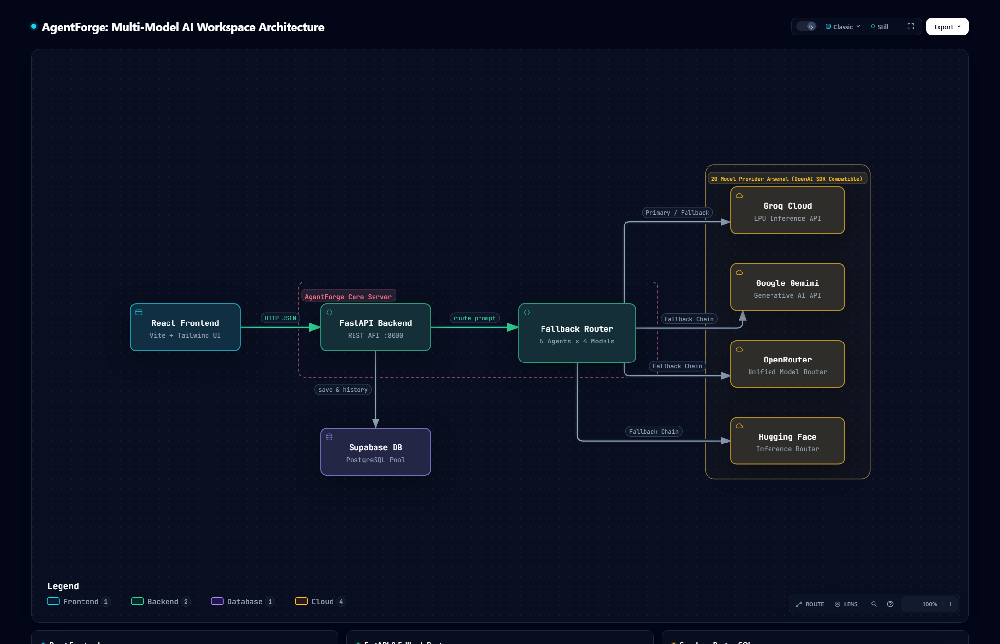

# 🛠️ AgentForge: The Multi-Model AI Workspace

> **Problem:** Relying on a single AI provider creates vendor lock-in, leads to API downtime, and wastes compute costs by using massive models for simple tasks.
>
> **Solution:** A production-grade Mixture-of-Experts (MoE) architecture that routes user prompts to the optimal AI model across 5 specialized agents (20 models total) with automatic failover.

[]()
[]()
[]()
[]()

---

## 📊 The Problem (The Market Gap)

- **The "Jack-of-All-Trades" Trap:** Using one massive model (like GPT-4) for everything wastes compute. A model that writes poetry is slow at generating structured JSON.
- **API Downtime:** If an enterprise relies solely on OpenAI or Google, a single API outage crashes their entire application.
- **Lack of Visibility:** Companies lack visibility into *which* model answered a query, how long it took, and whether they are hitting rate limits.
- **Vendor Lock-in:** Hardcoding a single provider makes it nearly impossible to switch when prices rise or new models are released.

## 💡 The Solution

AgentForge acts as an intelligent "Traffic Cop" for AI. It sits between your frontend and the AI providers, making real-time decisions about where to send your prompt.

- **Intelligent Intent Routing:** A lightweight model intercepts the prompt and routes it to the correct specialized agent.
- **5 Specialized Agents (20 Models Total):** Coder, Reasoner, Speedster, Creative, and Analyst.
- **Resilient Fallback Chain:** Each agent has 1 primary model and 3 fallback models. If Groq fails, it instantly reroutes to Gemini or OpenRouter without the user noticing.
- **Manual Model Override:** Users can manually select a specific model within an agent's context, with graceful fallback if it fails.
- **Live Telemetry:** A UI dashboard displaying real-time metrics for every prompt.
- **Persistent History:** All chats are logged in PostgreSQL and can be resumed from the sidebar.

---

## 🏗️ Architecture


*(Visual representation of the React Frontend, FastAPI Backend, Fallback Router, 20 AI Models, and Supabase Database.)*

---

## 🧠 The 20-Model Arsenal

AgentForge uses a 4-tier fallback chain per agent. If the primary model fails or hits a rate limit, it instantly cascades to the next.

| Agent | Primary Model | Fallback 1 | Fallback 2 | Fallback 3 |
| :--- | :--- | :--- | :--- | :--- |
| **💻 Coder** | `openai/gpt-oss-120b` (Groq) | `deepseek-coder` (OpenRouter) | `qwen-coder` (OpenRouter) | `Qwen2.5-Coder` (HuggingFace) |
| **🧠 Reasoner** | `openai/gpt-oss-120b` (Groq) | `llama-3.1-70b` (OpenRouter) | `llama-3.1-70b` (HuggingFace) | `openrouter/free` (OpenRouter) |
| **⚡ Speedster** | `llama-3.1-8b-instant` (Groq) | `gemma-7b-it` (Groq) | `mistral-7b` (OpenRouter) | `openrouter/free` (OpenRouter) |
| **🎨 Creative** | `claude-3.5-sonnet` (OpenRouter) | `llama-3.1-8b` (OpenRouter) | `openai/gpt-oss-20b` (Groq) | `gemini-1.5-pro` (Gemini) |
| **📊 Analyst** | `phi-3-medium` (OpenRouter) | `openai/gpt-oss-20b` (Groq) | `gemini-1.5-pro` (Gemini) | `openrouter/free` (OpenRouter) |

---

## 📁 Project Structure

```text
AgentForge/
├── backend/
│   ├── .env                  # API Keys (Ignored in Git)
│   ├── requirements.txt      # Python Dependencies
│   ├── db.py                 # Supabase PostgreSQL connection & queries
│   ├── registry.py           # 20-Model configuration dictionary
│   └── main.py               # FastAPI server, fallback engine, telemetry
├── frontend/
│   ├── src/
│   │   ├── components/
│   │   │   ├── Sidebar.jsx   # Agent selection & history
│   │   │   ├── ChatWindow.jsx# Chat UI with Markdown/LaTeX
│   │   │   └── Telemetry.jsx # Real-time latency & model tracking
│   │   ├── App.jsx           # Main UI layout & state management
│   │   └── index.css         # Tailwind configuration
│   ├── package.json
│   └── vite.config.js
├── docs/
│   ├── architecture.html     # Interactive Archify diagram
│   └── architecture.png      # Screenshot for README rendering
└── README.md
```

---

## 🛠️ Tech Stack

| Category | Technologies |
| :--- | :--- |
| **Frontend** | React, Vite, Tailwind CSS, Axios, React-Markdown, KaTeX |
| **Backend** | Python, FastAPI, Uvicorn, OpenAI SDK (Universal Client) |
| **Database** | Supabase (PostgreSQL) with Connection Pooling |
| **AI Providers** | Groq, Google Gemini, OpenRouter, Hugging Face |
| **Tooling** | Archify (Architecture Diagrams), Antigravity IDE |

---

## 🚀 How to Run This Project

### 1. Clone the Repository
```bash
git clone https://github.com/KhizarNaveed/AgentForge.git
cd AgentForge
```

### 2. Backend Setup
```bash
cd backend
python -m venv .venv
source .venv/bin/activate  # Windows: .\.venv\Scripts\activate
pip install -r requirements.txt
```

Create a `.env` file in the `backend/` folder with your keys:
```env
GROQ_API_KEY=your_key
GEMINI_API_KEY=your_key
OPENROUTER_API_KEY=your_key
HF_TOKEN=your_key
SUPABASE_URL=your_url
SUPABASE_SERVICE_ROLE_KEY=your_key
DATABASE_URL=your_postgres_url
```

Run the server:
```bash
uvicorn main:app --reload
```

### 3. Frontend Setup
```bash
cd frontend
npm install
npm run dev
```
Open `http://localhost:5173` in your browser.

---

## 🔮 Future Improvements
- [ ] Implement streaming responses (SSE) for real-time typing effect.
- [ ] Add image and video generation agents.
- [ ] Deploy backend to Render and frontend to Vercel.
- [ ] Add a "Cost Tracking" dashboard (estimate $ saved by using free models).

---

## 📬 Connect with Me
- **LinkedIn:** [Muhammad Khizar Naveed](https://www.linkedin.com/in/muhammad-khizar-naveed-1767312b2/)
- **GitHub:** [KhizarNaveed](https://github.com/KhizarNaveed)

**⭐ If you found this project useful, please consider giving it a star!**
